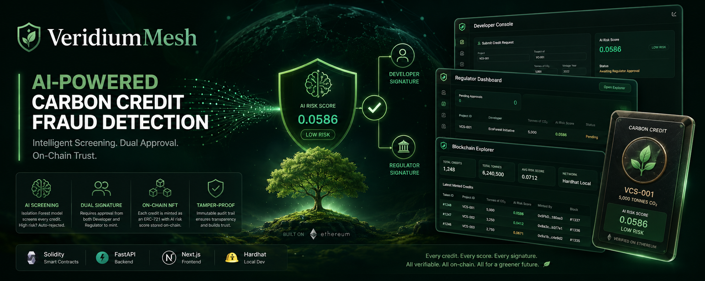
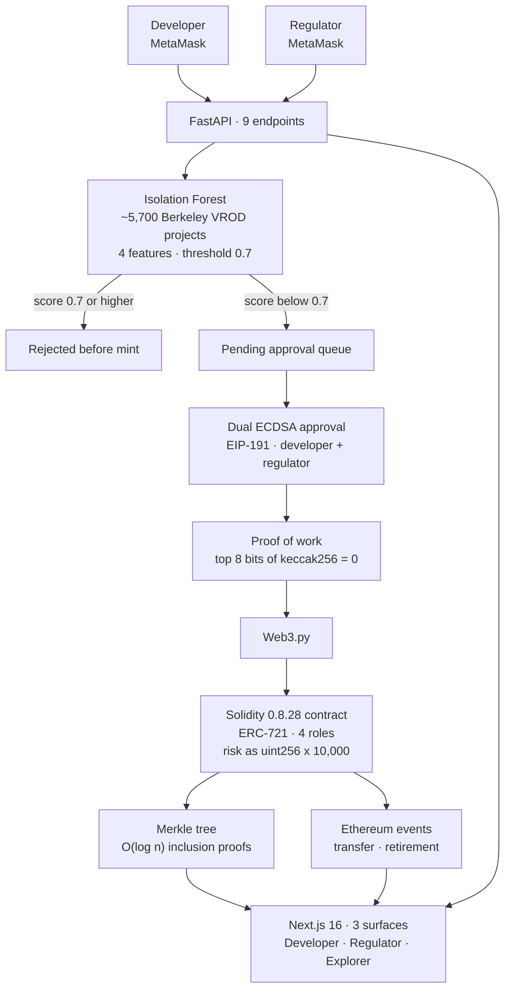
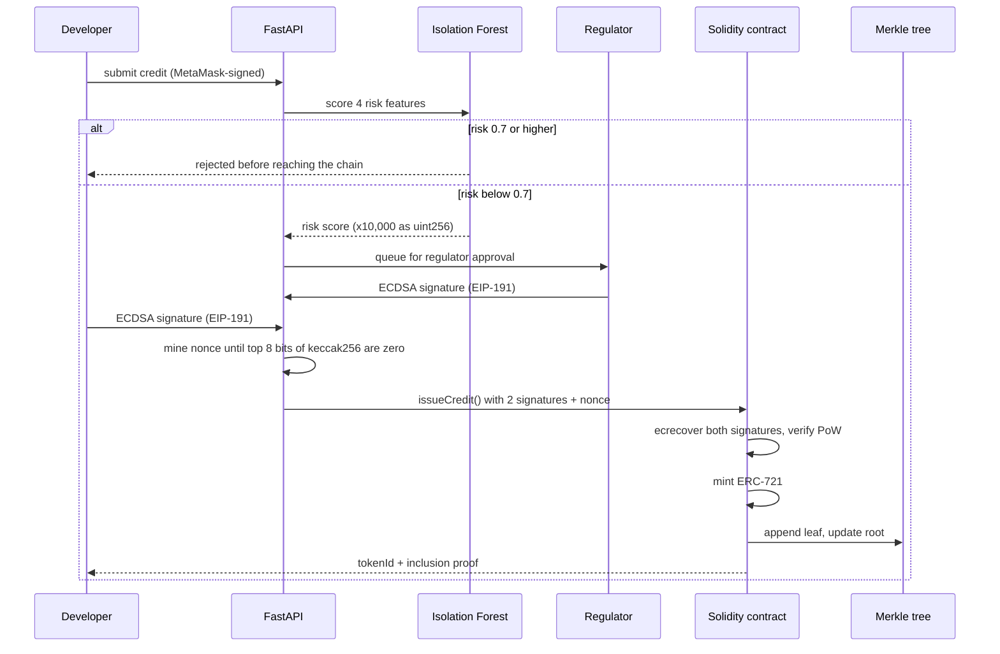

<div align="center">



# VeridiumMesh
### AI-Gated Carbon Credit Verification on Ethereum

[](https://python.org)
[](https://fastapi.tiangolo.com)
[](https://soliditylang.org)
[](https://nextjs.org)
[](https://hardhat.org)
[](https://scikit-learn.org)
[](LICENSE)

*CSE540 Blockchain — Team 16 · Arizona State University · Spring 2026*

**Risky credits are blocked *before* mint, not audited after the damage.**

</div>

---

## Highlights

- Built an **AI-gated blockchain issuance platform** for a carbon-credit market facing fraud, double-counting and over-issuance at **$2B+** scale, where suspicious credits never reach the smart contract.
- Trained an **Isolation Forest** on approximately **5,700 Berkeley VROD** carbon-credit projects and used a **0.7 risk threshold** to reject submissions before minting.
- Engineered **4 risk features** — `R_ratio`, `Vintage_Age`, `M_flag`, `T_flag` — catching patterns such as **600,000-tonne** solar claims and **18-year** vintages scoring around **0.85**, against low-risk **5,000-tonne** cookstove projects at **0.25**.
- Encoded AI risk as a `uint256` scaled by **10,000**, since Solidity has no floating point — preserving decimal precision on-chain while keeping the contract deterministic and audit-friendly.
- Implemented **dual ECDSA approval** with EIP-191 hashing and Solidity `ecrecover`, requiring **2 independent signatures** from a registered developer and a regulator before `issueCredit()` can mint.
- Built **ERC-721** issuance with **4 on-chain roles** — admin, registrar, developer, regulator — plus transfer and irreversible retirement flows logged through Ethereum events.
- Added **proof-of-work** anti-spam requiring the top **8 bits** of `keccak256(creditId + nonce)` to be zero, costing roughly **256 attempts** per mint on average.
- Stored each issued credit as a **Merkle-tree leaf** and exposed **O(log n)** inclusion proofs verifiable directly against the on-chain root, so auditors never have to trust the backend.
- Delivered an **8-step lifecycle** from MetaMask submission through AI scoring, regulator approval, PoW mining, dual-signature verification, ERC-721 minting, Merkle update, transfer and retirement.
- Exposed **9 FastAPI endpoints** for issuance, pending queues, regulator approval, credit lookup, Merkle proofs, chain stats, chain events and stakeholder discovery.
- Wrote **30+ Hardhat Mocha tests** covering PoW validation, dual-signature minting, role access control, transfers, retirement, Merkle proof verification and edge-case reverts, plus a **pytest + httpx** suite against the FastAPI request paths.
- Built **3 Next.js 16 surfaces** — Developer Console, Regulator Dashboard and Blockchain Explorer — connecting MetaMask signing, backend scoring, Web3.py minting and on-chain verification.

---

## Architecture



## The 8-step issuance lifecycle



---

## Risk scoring in practice

| Project | Volume | Vintage | Risk score | Outcome |
|---|---|---|---|---|
| Cookstove | 5,000 t | recent | **0.25** | Issued |
| Solar | 600,000 t | 18 years | **0.85** | Rejected before mint |

## On-chain roles

| Role | Can do |
|---|---|
| **Admin** | Manage registrar, system parameters |
| **Registrar** | Register developers and regulators |
| **Developer** | Submit credits, sign issuance, transfer |
| **Regulator** | Approve or reject, co-sign issuance |

## Tech stack

**ML** Python · scikit-learn Isolation Forest · Pandas · NumPy
**Backend** FastAPI · Uvicorn · Pydantic · Web3.py · pytest · httpx
**Chain** Solidity 0.8.28 · ERC-721 · OpenZeppelin · Hardhat · Ethereum · ECDSA · EIP-191 · `ecrecover` · keccak256 PoW · Merkle proofs
**Frontend** Next.js 16 · TypeScript · Tailwind CSS · shadcn/ui · ethers.js · MetaMask

## Quick start

```bash
git clone https://github.com/Brijesh03032001/veridiumMesh.git
cd veridiumMesh
```

```bash
npx hardhat node          # local chain
npx hardhat run scripts/deploy.js --network localhost
npx hardhat test          # 30+ Mocha tests
```

```bash
cd backend && pip install -r requirements.txt && uvicorn main:app --port 8000
pytest                    # FastAPI request-path suite
```

```bash
cd frontend && npm install && npm run dev
```

---

**Built by [Brijesh Kumar](https://github.com/Brijesh03032001)** · [Portfolio](https://brijeshbuilds.com) · [LinkedIn](https://linkedin.com/in/brijeshkumar03)
